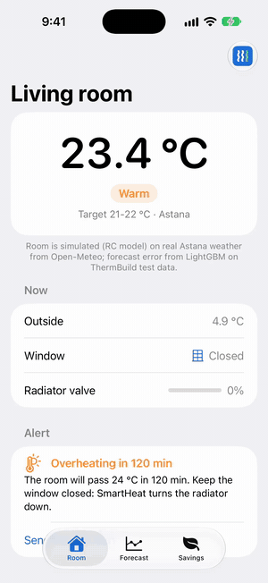
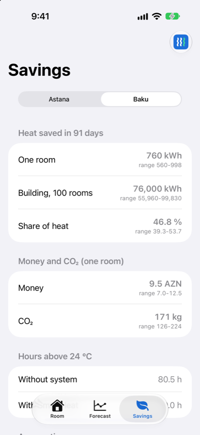
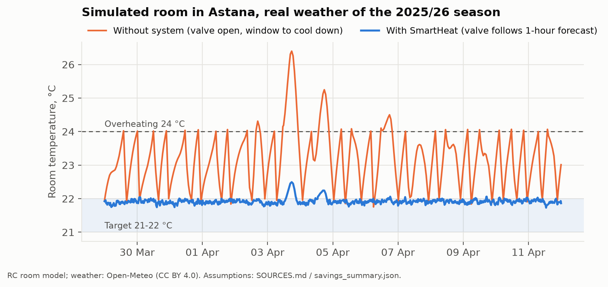

<p align="center">
  <picture>
    <source media="(prefers-color-scheme: dark)" srcset="docs/brand/logo_white.png">
    
  </picture>
</p>

<p align="center"><b>Stop overheating in centrally heated buildings, before it starts.</b></p>

<p align="center">Our project for the <b>CECECO Clean Energy Hackathon 2027</b>, track "Bring Clean Energy to Everyday Life".</p>

<p align="center">
  
</p>

## The problem

In many buildings in Kazakhstan and Azerbaijan, heat comes from a central system and nobody can turn it down
in their own room. In spring and autumn rooms get too hot, so people open the windows and the heat goes outside.
That is wasted energy, wasted money and extra CO₂.

## Our idea

1. **Sense.** A small sensor measures the room temperature and sees if the window is open.
2. **Predict.** A machine learning model predicts the room temperature for the next 1-3 hours.
3. **Act early.** If the room is about to get too hot, a smart valve turns the radiator down before it happens.
4. **Inform.** An iPhone app shows the room, warns about overheating and shows the energy saved.


The forecast model, the simulation and the app work. The sensors and valves are a concept for now.

## The app

<p align="center">
  
  
  
  
</p>

**Room:** the temperature now, the window, the radiator valve and an overheating alert.
**Forecast:** the next 3 hours with and without SmartHeat, plus tips.
**Savings:** heat, money and CO₂ saved per room and per building, for Astana and Baku.
A phone notification warns before the room overheats. Full demo video: [docs/media/demo.mp4](docs/media/demo.mp4).

## Results

**Forecast:** 0.08 °C error one hour ahead and 0.17 °C three hours ahead, tested on real measurements the model
never saw. That is 37-46 % better than a simple "no change" guess.

**Savings** (simulated room, real weather of the 2025/26 heating season):

| Per room, one season | Astana, Kazakhstan | Baku, Azerbaijan |
|---|---|---|
| Heat saved | 6-19 % (base 484 kWh) | 39-54 % (base 760 kWh) |
| CO₂ avoided | about 194 kg | about 171 kg |
| Money saved | about 1,690 KZT ($3.7) | about 9.5 AZN ($5.6) |
| Hours above 24 °C | 80 → 0 | 80 → 0 |

**Hardware:** about $55 per room, payback about 15 years in Astana and 10 years in Baku at today's low household
tariffs (lite kit: 8 and 5 years). See the [cost estimate](docs/cost_estimate.md).



The savings come from a simulation, not from a real building. The Baku result depends more on assumptions.
All sources and assumptions are in [SOURCES.md](SOURCES.md).

## Run it yourself

You need Python 3 and, for the app, a Mac with Xcode.

```bash
python3 -m venv .venv && .venv/bin/pip install --only-binary :all: -r requirements.txt
```

On a Mac, LightGBM also needs OpenMP: `brew install libomp`.

Download `ThermBuild_measure_imputed.zip` (link in [SOURCES.md](SOURCES.md)), unzip it into
`data/raw/thermbuild/`, then run the whole pipeline:

```bash
.venv/bin/python src/weather.py && .venv/bin/python src/prepare.py && .venv/bin/python src/model.py && .venv/bin/python src/export.py && .venv/bin/python src/figures.py
```

Run the tests:

```bash
python3 tests/test_simulate.py -v
```

To see the app, open `ios/SmartHeat/SmartHeat.xcodeproj` in Xcode, pick your own team under
Signing & Capabilities and press Run.

## What is in this repository

| Path | What it is |
|---|---|
| `src/` | Python: weather download, data cleaning, forecast model, savings simulation, app data, charts, diagram |
| `ios/SmartHeat/` | The iPhone app (SwiftUI) |
| `figures/` | Charts and result numbers |
| `docs/` | Cost estimate, app data format, screenshots, demo video, logo |
| `tests/` | Tests for the simulation |

## Data and credits

- Room measurements: **ThermBuild** dataset, Fraunhofer, [CC BY-SA 4.0](https://creativecommons.org/licenses/by-sa/4.0/)
  ([paper](https://arxiv.org/abs/2606.01994), [data](https://fordatis.fraunhofer.de/handle/fordatis/486)).
- Weather: [Open-Meteo](https://open-meteo.com/), CC BY 4.0, free API for non-commercial use.
- Heat tariffs and exchange rates: see [SOURCES.md](SOURCES.md).

## License

The code is under the [MIT License](LICENSE). The data belongs to its owners and keeps its own license (see above).

## Team

Four students from ADA University, Baku.
