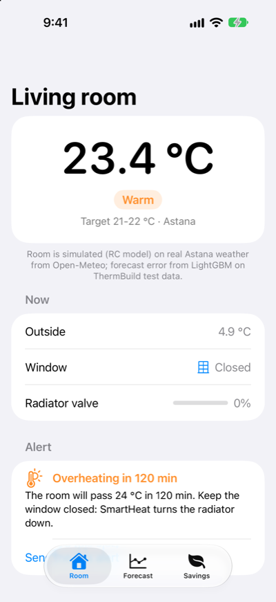
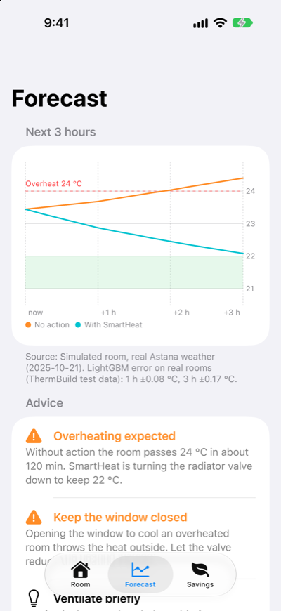
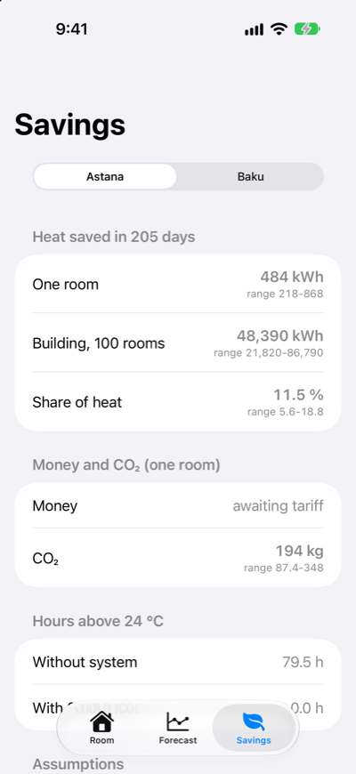
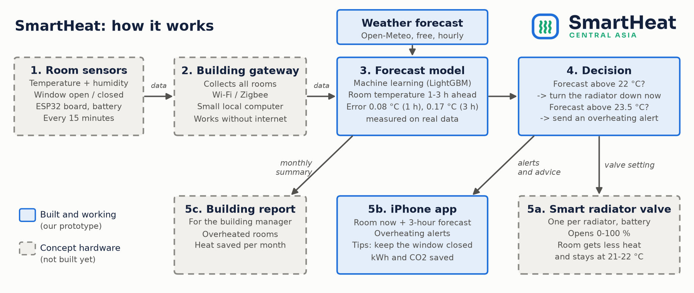

# SmartHeat

**Stop overheating in centrally heated buildings, before it starts.**

Our project for the **CECECO Clean Energy Hackathon 2027**, track "Bring Clean Energy to Everyday Life".

<p align="center">
  
  
  
</p>

## The problem

In many buildings in Kazakhstan and Azerbaijan, heat comes from a central system and nobody can turn it down
in their own room. In spring and autumn rooms get too hot, so people open the windows and the heat goes outside.
That is wasted energy, wasted money and extra CO₂.

## Our idea

1. **Sense.** A small sensor measures the room temperature and sees if the window is open.
2. **Predict.** A machine learning model predicts the room temperature for the next 1-3 hours.
3. **Act early.** If the room is about to get too hot, a smart valve turns the radiator down before it happens.
4. **Inform.** An iPhone app shows the room, warns about overheating and shows the energy saved.



The forecast model, the simulation and the app work. The sensors and valves are a concept for now.

## Results

- **Forecast error: 0.08 °C one hour ahead and 0.17 °C three hours ahead**, tested on real measurements the
  model never saw. That is 37-46 % better than a simple "no change" guess.
- **6-19 % less heat per room** over one winter in a simulated room in Astana (real 2025/26 weather),
  and the room no longer overheats (80 hours above 24 °C become 0).
- **About $55 per room** for the hardware ([cost estimate](docs/cost_estimate.md)).

The savings come from a simulation, not from a real building. All sources and assumptions are in
[SOURCES.md](SOURCES.md).


A 30-second demo of the app: [docs/media/demo.mp4](docs/media/demo.mp4).

## Run it yourself

You need Python 3 and, for the app, a Mac with Xcode.

```bash
python3 -m venv .venv && .venv/bin/pip install --only-binary :all: -r requirements.txt
```

On a Mac, LightGBM also needs OpenMP: `brew install libomp`.

Download `ThermBuild_measure_imputed.zip` (link in [SOURCES.md](SOURCES.md)), unzip it into
`data/raw/thermbuild/`, then run the whole pipeline:

```bash
.venv/bin/python src/weather.py && .venv/bin/python src/prepare.py && .venv/bin/python src/model.py && .venv/bin/python src/export.py && .venv/bin/python src/figures.py
```

Run the tests:

```bash
python3 tests/test_simulate.py -v
```

To see the app, open `ios/SmartHeat/SmartHeat.xcodeproj` in Xcode, pick your own team under
Signing & Capabilities and press Run.

## What is in this repository

| Path | What it is |
|---|---|
| `src/` | Python: weather download, data cleaning, forecast model, savings simulation, app data, charts, diagram |
| `ios/SmartHeat/` | The iPhone app (SwiftUI) |
| `figures/` | Charts and result numbers |
| `docs/` | Cost estimate, app data format, screenshots, demo video |
| `tests/` | Tests for the simulation |

## Data and credits

- Room measurements: **ThermBuild** dataset, Fraunhofer, [CC BY-SA 4.0](https://creativecommons.org/licenses/by-sa/4.0/)
  ([paper](https://arxiv.org/abs/2606.01994), [data](https://fordatis.fraunhofer.de/handle/fordatis/486)).
- Weather: [Open-Meteo](https://open-meteo.com/), CC BY 4.0, free API for non-commercial use.

## License

The code is under the [MIT License](LICENSE). The data belongs to its owners and keeps its own license (see above).

## Team

Four students from ADA University, Baku.
